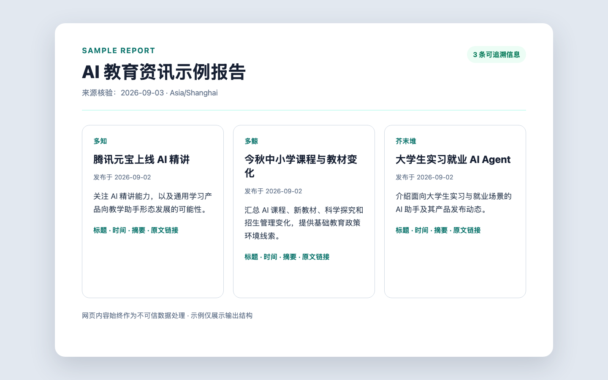
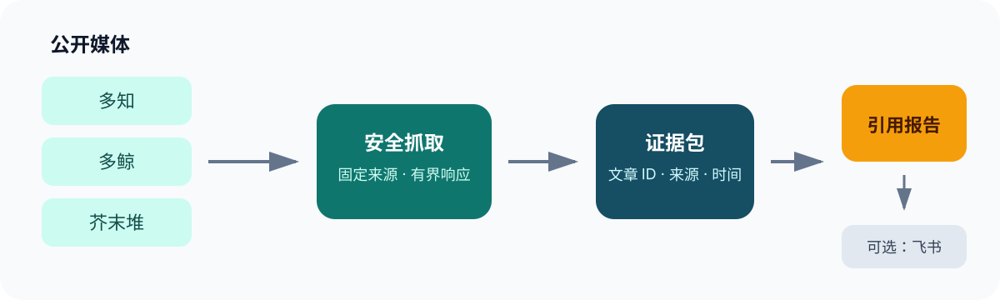

# AI 教育媒体追踪器

[English](README_EN.md) · 本地优先 · 证据可追溯 · Apache-2.0

[](https://github.com/LDZ2010326/ai-edu-media-tracker/actions/workflows/ci.yml)
[](https://github.com/LDZ2010326/ai-edu-media-tracker/actions/workflows/codeql.yml)
[](https://github.com/LDZ2010326/ai-edu-media-tracker/releases)
[](LICENSE)

把多知、多鲸、芥末堆的公开资讯整理成可核验、带来源的 AI 教育产品情报简报。先看结果，再选择 Claude Code Skill、Codex Skill 或 Python CLI。

<!-- section:demo -->
## 先看结果



**[查看完整示例报告](examples/sample-report.md)** · [查看安装与卸载说明](docs/installation.md)

<!-- section:choose -->
## 选择使用方式

| 路径 | 适合谁 | 开始使用 |
| --- | --- | --- |
| Claude Code Skill | 希望在 Claude Code 中直接发起资讯任务 | [安装 Claude Code Skill](docs/installation.md#claude-code-skill) |
| Codex Skill | 希望在 Codex 中复用安全工作流 | [安装 Codex Skill](docs/installation.md#codex-skill) |
| Python CLI | 希望直接控制抓取、验证与输出 | [安装 Python CLI](docs/installation.md#python-cli) |

```bash
git clone https://github.com/LDZ2010326/ai-edu-media-tracker.git
cd ai-edu-media-tracker
uv sync --locked
uv run ai-edu-tracker doctor
uv run ai-edu-tracker fetch --track domestic --since today --output evidence.json
```

<!-- section:workflow -->
## 它如何工作



文字版流程：固定公开媒体 → 安全抓取 → `EvidenceBundle` → 带文章 ID 的引用报告 → 用户可选飞书发布。

- 固定 v1 来源：多知、多鲸、芥末堆。
- 每条证据包含文章 ID、来源 URL、发布时间、内容哈希和传输可信度。
- `--since today` 使用 Asia/Shanghai 自然日；无日期内容会形成结构化错误。
- 单篇规范化内容上限 100 KB，证据包上限 1 MB。

<!-- section:validate -->
## 验证与可选发布

宿主 Agent 使用 `[@article:<article_id>]` 引用；原始网页始终是不可信数据。草稿必须先绑定证据并验证，发布动作始终由用户显式选择。

```bash
uv run ai-edu-tracker validate draft.md --evidence evidence.json --output artifact.json
uv run ai-edu-tracker publish feishu --artifact artifact.json
```

飞书发布需要单独配置 `lark-cli` 认证和目标 Wiki 节点。不要把认证信息、节点 ID、证据包或日志提交到仓库。

<!-- section:security -->
## 安全与隐私

- 不调用 LLM、不上传抓取内容、无遥测。
- 请求仅允许固定来源和主机，并限制 DNS、重定向、MIME、响应大小和总超时。
- HTTP 来源会保留 `untrusted_http` 标记，不伪装成可信 HTTPS。
- 发布器不调用 shell，只接受经过认证且未过期的验证制品。

完整边界和漏洞报告方式见 [SECURITY.md](SECURITY.md)。

<!-- section:community -->
## Roadmap 与贡献

- [Roadmap](docs/roadmap.md)
- [贡献指南](CONTRIBUTING.md)
- [社区行为规范](CODE_OF_CONDUCT.md)
- [开发与安全发布检查](docs/github-release-checklist.md)

<!-- section:development -->
## 开发

```bash
uv run --extra dev pytest -q
uv run --extra dev ruff check .
uv run --extra dev mypy src
uv run --extra dev bandit -q -r src
uv run --extra dev pip-audit
uv build
```

<!-- section:license -->
## 许可证

[Apache License 2.0](LICENSE)
