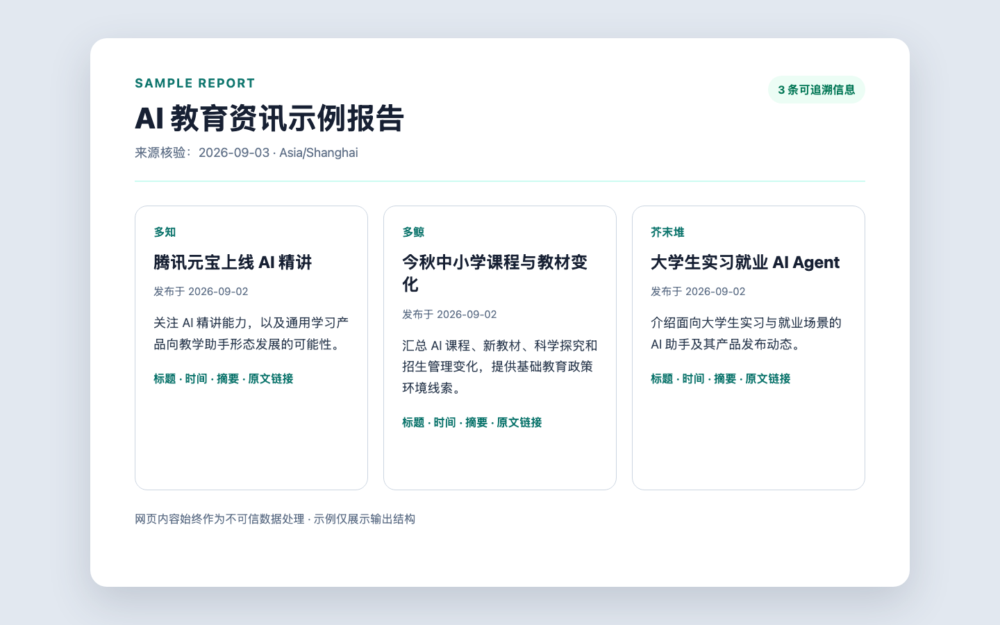
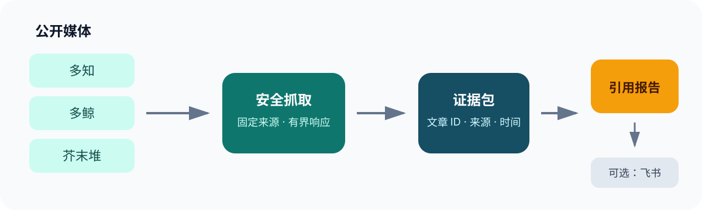

# AI Education Media Tracker

[中文](README.md) · Local-first · Evidence-bound · Apache-2.0

[](https://github.com/LDZ2010326/ai-edu-media-tracker-public/actions/workflows/ci.yml)
[](https://github.com/LDZ2010326/ai-edu-media-tracker-public/actions/workflows/codeql.yml)
[](https://github.com/LDZ2010326/ai-edu-media-tracker-public/releases)
[](LICENSE)

Turn public updates from Duozhi, Duojing, and Jiemodui into verifiable AI-education product briefs with traceable sources. See the result first, then choose the Claude Code Skill, Codex Skill, or Python CLI.

<!-- section:demo -->
## See the result



**[Open the complete sample report](examples/sample-report.md)** · [Read installation and removal instructions](docs/installation.md)

<!-- section:choose -->
## Choose how to use it

| Route | Best for | Get started |
| --- | --- | --- |
| Claude Code Skill | Starting media-tracking tasks directly in Claude Code | [Install the Claude Code Skill](docs/installation.md#claude-code-skill) |
| Codex Skill | Reusing the safe workflow in Codex | [Install the Codex Skill](docs/installation.md#codex-skill) |
| Python CLI | Direct control over collection, validation, and output | [Install the Python CLI](docs/installation.md#python-cli) |

```bash
git clone https://github.com/LDZ2010326/ai-edu-media-tracker-public.git ai-edu-media-tracker
cd ai-edu-media-tracker
uv sync --locked
uv run ai-edu-tracker doctor
uv run ai-edu-tracker fetch --track domestic --since today --output evidence.json
```

<!-- section:workflow -->
## How it works



Text flow: fixed public media → safe collection → `EvidenceBundle` → article-ID-cited brief → optional user-approved Feishu publishing.

- Fixed v1 sources: Duozhi, Duojing, and Jiemodui.
- Every evidence record carries an article ID, source URL, publication time, content hash, and transport trust.
- `--since today` uses an Asia/Shanghai calendar day; undated content becomes a structured error.
- Normalized content is capped at 100 KB per article and 1 MB per bundle.

<!-- section:validate -->
## Validation and optional publishing

The host agent cites `[@article:<article_id>]`; raw web content always remains untrusted data. A draft must be evidence-bound and validated first, and publishing always requires an explicit user choice.

```bash
uv run ai-edu-tracker validate draft.md --evidence evidence.json --output artifact.json
uv run ai-edu-tracker publish feishu --artifact artifact.json
```

Feishu publishing requires separately configured `lark-cli` authentication and a destination Wiki node. Never commit authentication data, node IDs, evidence bundles, or logs.

<!-- section:security -->
## Security and privacy

- No LLM calls, uploads of collected content, or telemetry.
- Requests are restricted to fixed sources and hosts, with DNS, redirect, MIME, response-size, and total-time limits.
- HTTP sources retain an `untrusted_http` marker and are never presented as trusted HTTPS.
- The publisher invokes no shell and accepts only authenticated, unexpired validation artifacts.

See [SECURITY.md](SECURITY.md) for the complete boundary and vulnerability-reporting process.

<!-- section:community -->
## Roadmap and contributing

- [Roadmap](docs/roadmap.md)
- [Contributing guide](CONTRIBUTING.md)
- [Code of Conduct](CODE_OF_CONDUCT.md)
- [Development and secure-release checklist](docs/github-release-checklist.md)

<!-- section:development -->
## Development

```bash
uv run --extra dev pytest -q
uv run --extra dev ruff check .
uv run --extra dev mypy src
uv run --extra dev bandit -q -r src
uv run --extra dev pip-audit
uv build
```

<!-- section:license -->
## License

[Apache License 2.0](LICENSE)
